<div align="center">


# Reflectra

### *Every thought leaves a trace.*

**A mirror for your mind.** Talk to it like a friend. It listens, remembers your life and the people in it,<br/>
notices patterns you can't see yourself, and slowly learns to talk back *as you*.

<br/>

[](https://fastapi.tiangolo.com/)
[](https://react.dev/)
[](https://github.com/pgvector/pgvector)
[](https://ai.google.dev/)
[](https://supabase.com/)
[](https://reflectra-persona.vercel.app)

### [✨ Try it live → reflectra-persona.vercel.app](https://reflectra-persona.vercel.app)

<sub>Free to use · works in any browser · install it on your phone like an app</sub>

<br/>

<a href="docs/media/reflectra-demo.mp4">
  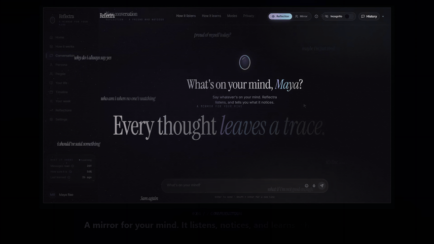
</a>

<sub>▶ <a href="docs/media/reflectra-demo.mp4"><b>Watch the full two-minute tour (MP4)</b></a> · everything shown is a made-up demo person, "Maya"</sub>

</div>

---

## Contents

- [What is Reflectra?](#what-is-reflectra) *(the plain-English version)*
- [A tour of the app](#a-tour-of-the-app) *(screenshots, explained simply)*
- [What it will never do](#what-it-will-never-do)
- [Under the hood](#under-the-hood) *(for engineers: architecture, algorithms, data model)*
- [Get it on your phone](#-get-it-on-your-phone)
- [Run it yourself](#run-it-yourself) · [Deploy it for free](#deploy-it-for-free)
- [Project layout](#project-layout)

---

## What is Reflectra?

Most chat apps forget you the moment you close them. Reflectra does the opposite.

Every time you talk to it, it quietly learns a little more about **how you think** (are you brief or wordy? quick to decide or careful?), **what's going on in your life** (your exams, your job hunt, your morning runs), and **who matters to you** (your best friend, your mum, your boss). Then it uses all of that to talk to you like someone who actually knows you.

New here? A short **tutorial** walks you through it the first time you open the app, with each slide showing the exact button to tap on a real screen (PC or phone). Skip it anytime, and replay it from the **Tutorial** button at the top left of the homepage.

It has two ways to talk:

| | |
|---|---|
| 🪞 **Reflection mode** | A friend who notices things. It listens, asks the right question, and points out what it sees: *"You said the same thing about your last deadline."* |
| 👤 **Mirror mode** | It talks back **as you**, in your own words, slang and rhythm. Great for drafting a message the way you'd write it, or for hearing your own thoughts said back. |

And everything it believes about you is **visible and editable**. If it gets you wrong, you tell it, and it listens.

---

## A tour of the app

> Every screenshot below is the real app, running against a made-up person called **Maya**, a final-year architecture student. No real conversations appear anywhere in this README.

### 💬 Talk to it like you'd text a friend

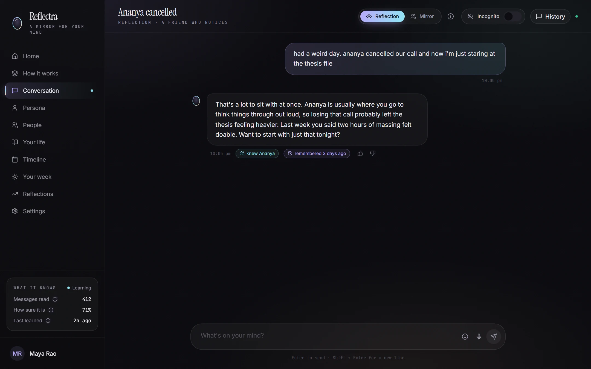

Maya mentions that her friend Ananya cancelled a call. The reply **already knows who Ananya is** (her best friend, the person she thinks out loud with), and **remembers** something Maya said three days earlier about her thesis.

The little chips under the reply show exactly what it used: **"knew Ananya"** and **"remembered 3 days ago"**. Tap one and it takes you to the source. Thumbs up or down teaches it what kind of replies you like. Say a reply was *too long* and the next ones get shorter.

<table>
<tr>
<td width="50%">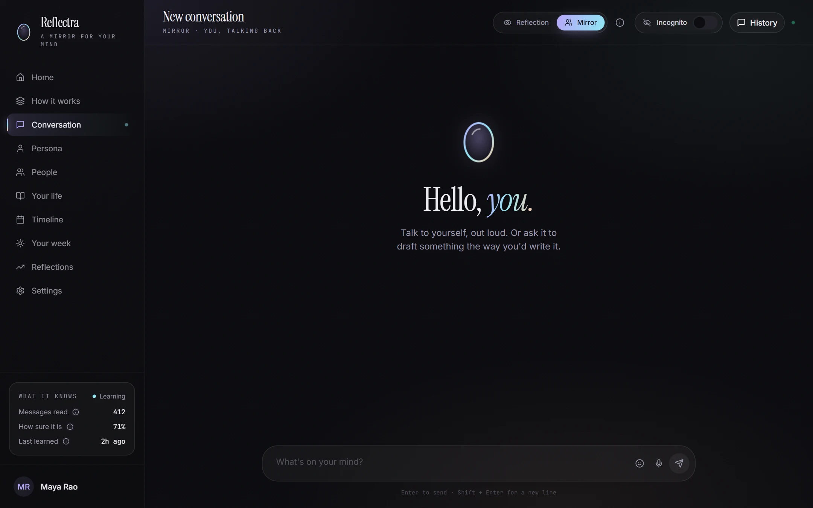</td>
<td width="50%">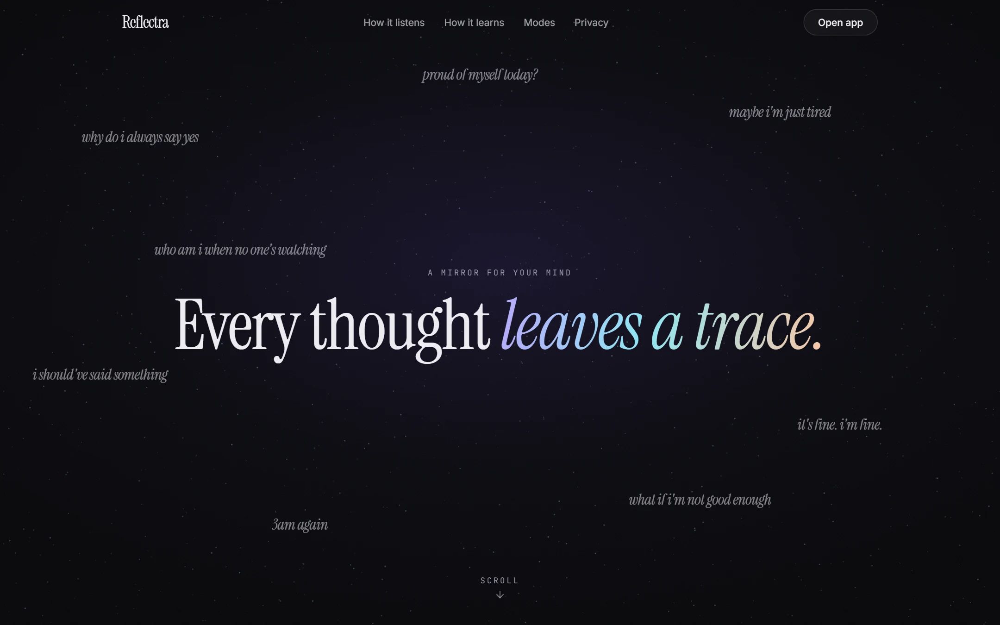</td>
</tr>
<tr>
<td><b>Mirror mode.</b> Flip the switch and it answers <i>as you</i>. It has studied how you actually type (lowercase? emojis? "ngl"?) and copies it.</td>
<td><b>The front door.</b> Thoughts drift past like they do at 3am. Your first message is the start of the portrait.</td>
</tr>
</table>

### 🧬 Your persona: the shape of how you think

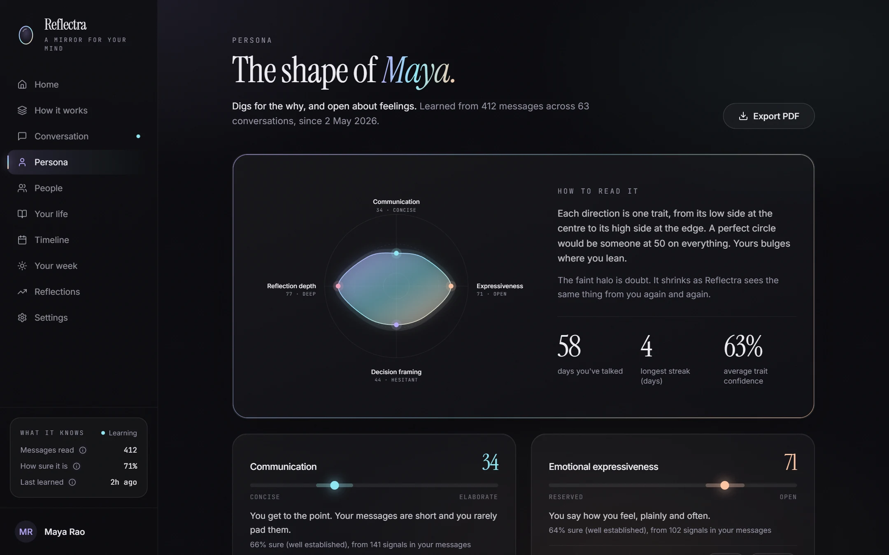

Reflectra measures four things from the way you write: **how much you say**, **how openly you share feelings**, **how quickly you decide**, and **how deep you dig into the why**. Together they make a shape. A perfect circle would be someone exactly average on everything; yours bulges where you lean. The faint halo around it is *doubt*, and it shrinks as Reflectra sees the same thing from you again and again.

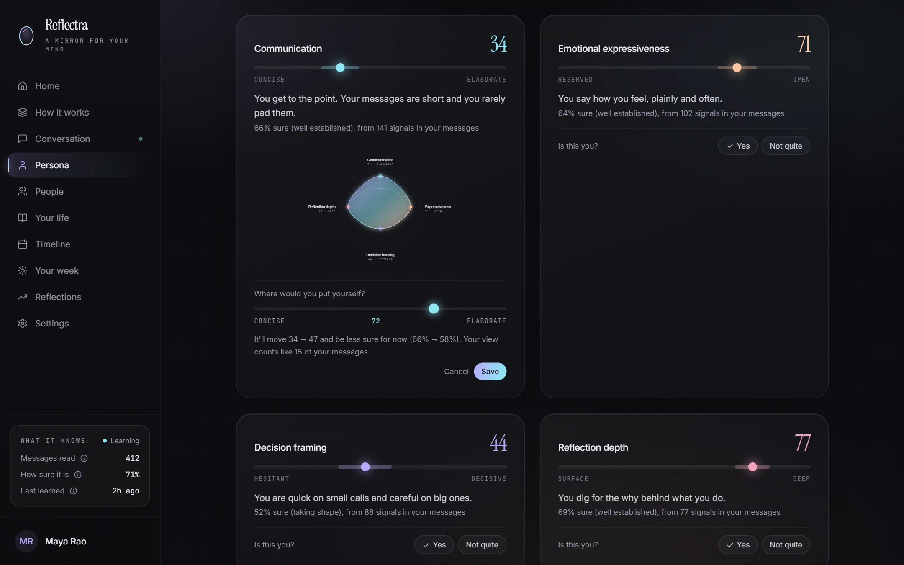

**Think it's wrong? Say so.** Tap *"Not quite"*, drag the slider to where you'd put yourself, and a small copy of your shape changes as you drag. It tells you exactly what will happen before you save: *"It'll move 34 → 47 and be less sure for now."* Your opinion counts like about 15 of your messages, so what you actually say in chat keeps the final word.

### 👥 The people in your story

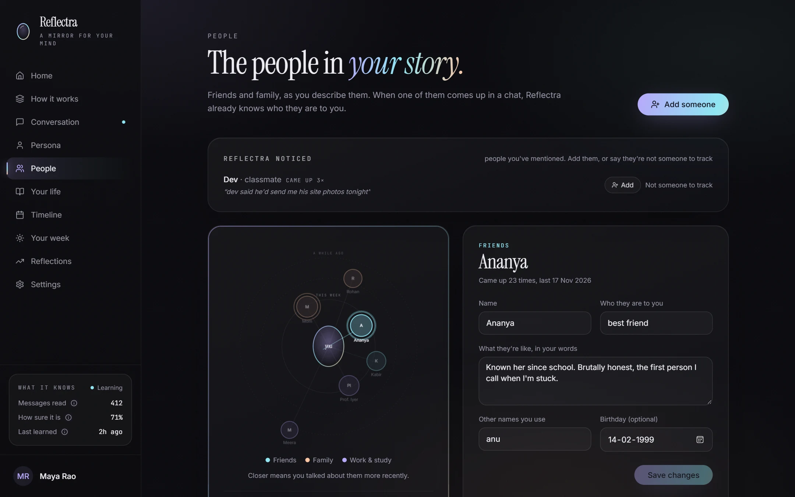

Add the people you talk about: name, who they are to you, and a sentence about them in your own words. From then on, whenever one of them comes up in a chat, Reflectra **already knows the context**.

They orbit around you: the closer someone is, the more recently they came up. People mentioned in the last couple of days give off a gentle ripple. And if someone keeps coming up who isn't in your list yet (like *Dev* above), Reflectra asks whether you'd like to add them.

### 📖 Your life, in your own words

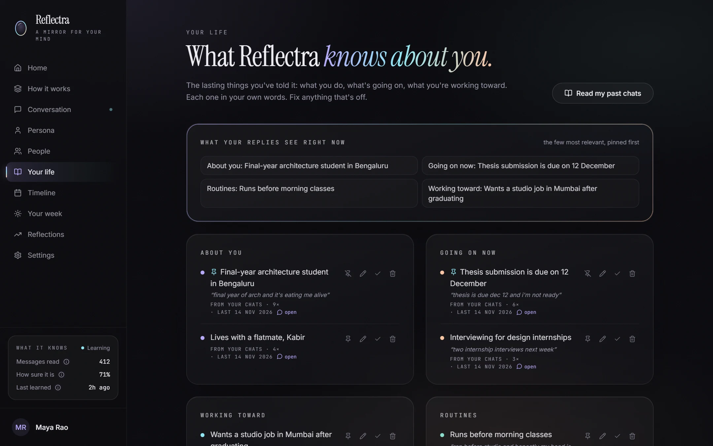

The lasting things: what you do, what's going on, what you're working toward. Each one is kept **in your own words**, with the quote it came from. Pin what matters most, fix anything that's off, mark things as done when they're over. Tap **"Read my past chats"** and it builds this list from everything you've already said.

### ✨ Patterns you can't see yourself

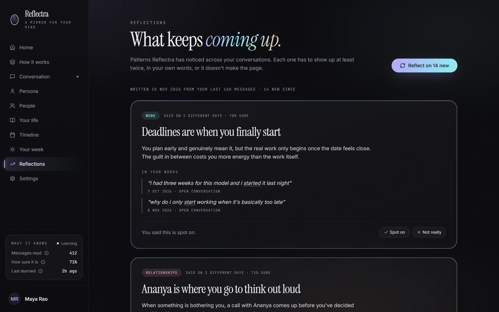

Every so often Reflectra reads back through your conversations and writes down **patterns**: *"Deadlines are when you finally start."* The rule is strict: a pattern only makes the page if it showed up on **at least two different occasions**, and every quote shown is checked to be **word for word** something you actually said. Words your quotes share get underlined, so you can see the thread. Tell it *"Spot on"* or *"Not really"*, and it learns from that too.

### 📅 Your story, day by day

<table>
<tr>
<td width="50%">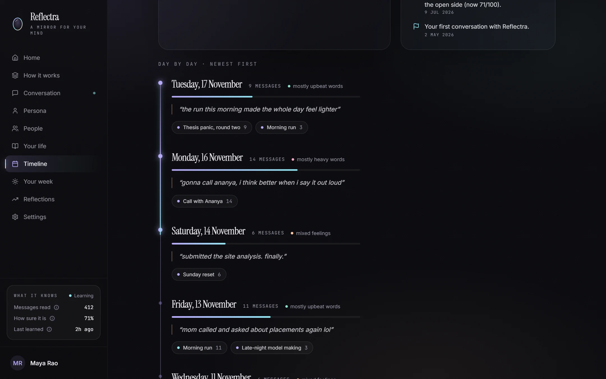</td>
<td width="50%">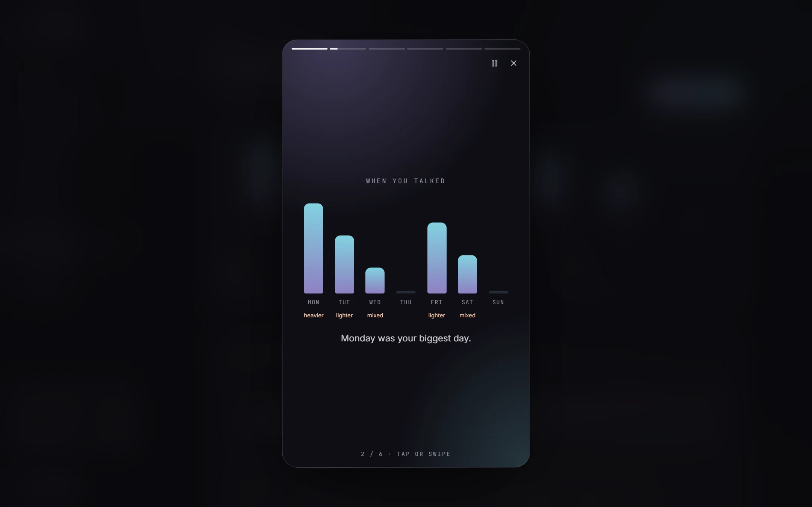</td>
</tr>
<tr>
<td><b>Timeline.</b> Every day you talked, with the moment that stood out, the mood of your words, and how your persona moved. A line of light runs down the days as you scroll.</td>
<td><b>Your week.</b> Every Sunday your week comes back as a short story: tap or swipe through when you talked, who came up, what's going on, and one pattern worth noticing.</td>
</tr>
</table>

### 🎨 Make it yours

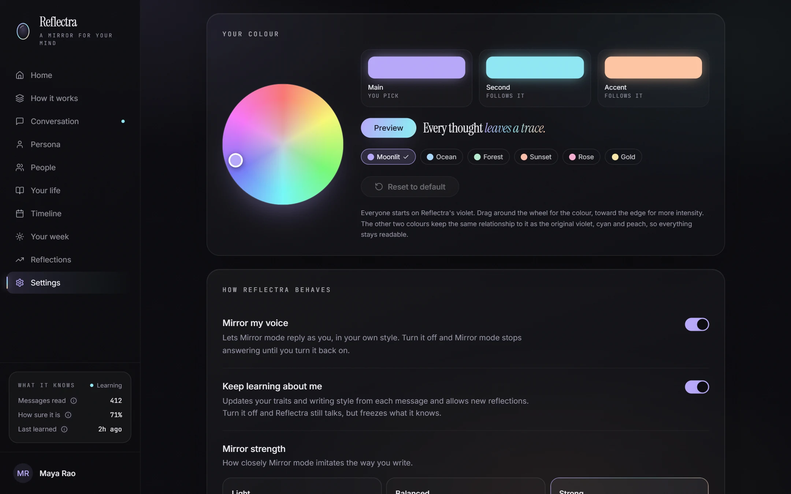

Pick any colour on the wheel and **the whole app follows**: buttons, glows, even the background tint. You pick the main colour; the second colour and the accent adjust themselves so everything stays readable. *Reset to default* brings back the original violet. Your choice is saved to your account, so it follows you to every device.

### 🔍 Nothing hidden

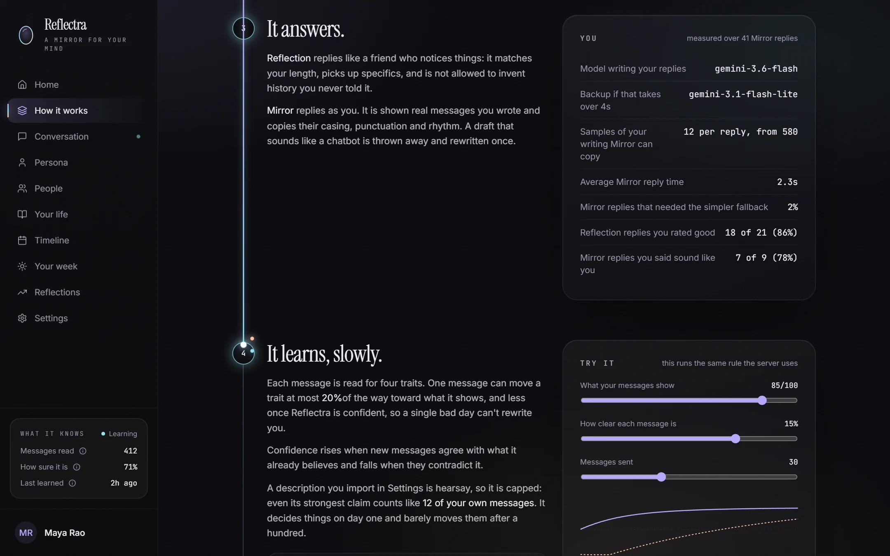

The **How it works** page shows the real path one message takes, using the **actual rules from the code** and your account's real numbers. You can even play with the learning rule yourself to see why one bad day can't rewrite who you are.

### 📄 Take your portrait with you

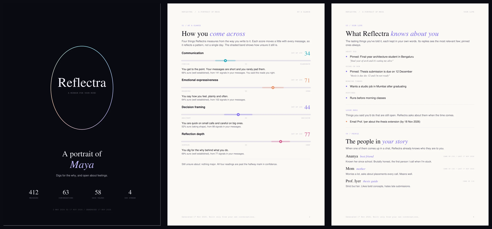

Export a printable PDF portrait: your traits, your patterns in your own words, your life and your people, how you've changed over time, and how you write. It's printed in your colour.

### 📱 Get it on your phone

<table>
<tr>
<td width="50%" align="center">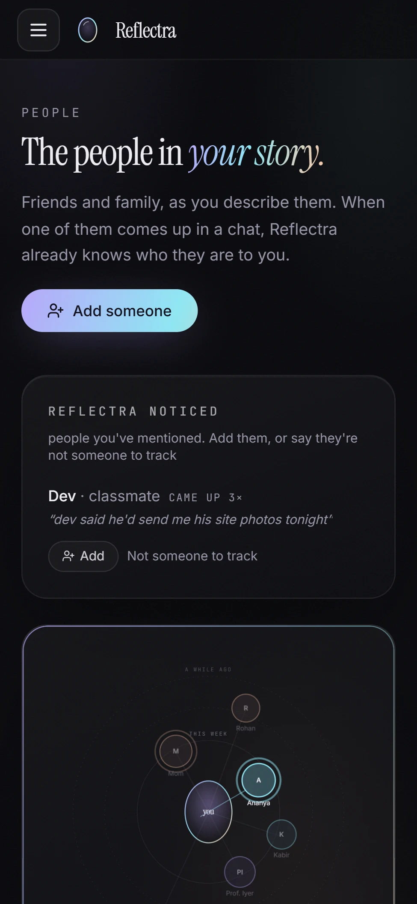</td>
<td width="50%" align="center">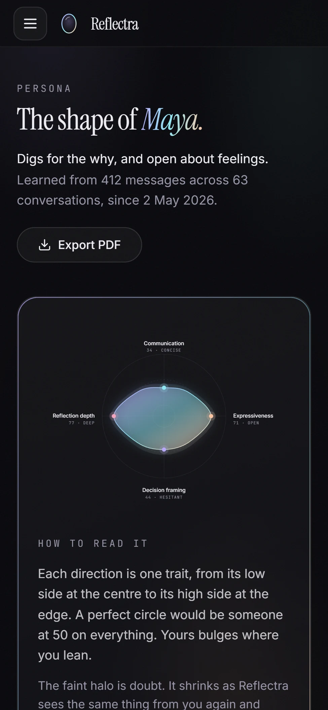</td>
</tr>
</table>

Reflectra installs straight from the browser, with no app store involved. Once it's on your home screen it opens full screen like any other app, starts even without a connection, and can send you reminders.

| | How to install |
|---|---|
| **Android** | Open [reflectra-persona.vercel.app](https://reflectra-persona.vercel.app) in **Chrome**, then tap **Install** on the card at the top of the chat (or Settings → *Get the app*). |
| **iPhone / iPad** | Open it in **Safari**, tap **Share** → **Add to Home Screen**, then open Reflectra from its new icon. |

Then turn on reminders in Settings → *About you*. It can gently check in on something you said you'd do (*"Did you email Prof. Iyer?"*), wish your people a happy birthday, and send your week on Sunday evening. It never sends more than one a day, and never during your quiet hours.

> On iPhone, notifications only work in the installed app (iOS 16.4 or later), not in a browser tab. Reflectra is already dark, so it asks browsers' night modes (Brave, Dark Reader, Samsung Internet) to leave its colours alone.

---

## What it will never do

- **Show your data to anyone else.** Every request is tied to your login on the server, and the database itself refuses to hand your rows to another account.
- **Learn from Incognito chats.** Incognito conversations aren't stored at all.
- **Make things up about you.** Patterns need your own quotes, checked word for word. Replies are told never to invent history you never shared.
- **Keep what you delete.** *Erase what Reflectra knows* wipes your conversations and everything learned from them. Deleting your account removes it all.
- **Pretend to be a therapist.** It's a mirror, not a diagnosis.

---

## Under the hood

> This part is for engineers. Everything below is how the code actually works today.

### Architecture

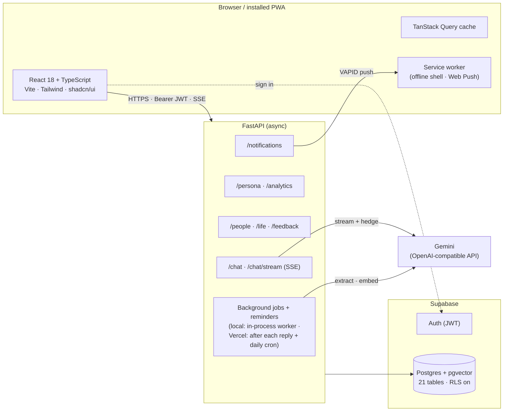

### Where it runs

| | |
|---|---|
| **Hosting** | One Vercel project with two [Services](https://vercel.com/docs/services): the Vite frontend at `/` and the FastAPI backend at `/api` (`vercel.json`). |
| **Region** | Backend functions run in **Singapore** (`sin1`), next to the Supabase database (`ap-southeast-1`), because every query is a round trip. Moving them there took a warm request from ~1.8 s to ~0.12 s. |
| **Background work** | Serverless can't keep a worker running, so the app calls `POST /api/jobs/run-mine` right after each reply, and **Vercel Cron** calls `/api/internal/tick` once a day (guarded by `CRON_SECRET`) for reminders, leftovers and cleanup. |
| **Voice typing** | Whisper/PyTorch is several GB, so it's an optional install (`requirements-voice.txt`); without it `/transcribe` answers 503 and everything else works. |
| **Cost** | Free tiers throughout: Vercel Hobby, Supabase Free, Gemini AI Studio key. No payment method anywhere. |

### The life of one message

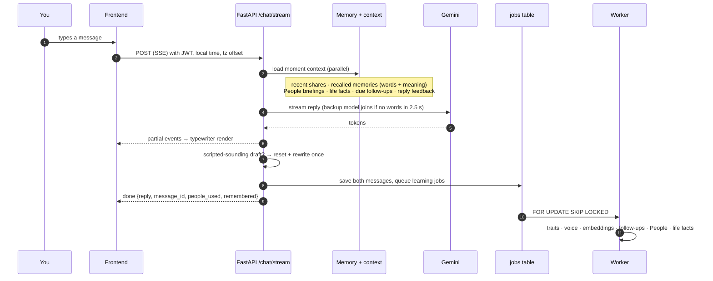

The reply is generated in the request; **everything Reflectra learns from it happens afterwards** in a background job, so learning never slows a reply down and a failed extraction never loses a message.

### The trait engine

Four traits, each a score `s ∈ [0,1]` with a confidence `c ∈ [0.05, 0.98]`. Every message produces a signal `x` with a strength `k` (capped at **0.2**):

```text
α  = k · (1 − 0.8 · c)          # inertia: the surer it is, the less one message moves it
s ← s + α · (x − s)

|x − s| ≤ 0.20  →  c ← c + 0.25 · k · (1 − c)      # agreement builds confidence
|x − s| ≥ 0.35  →  c ← c − 0.30 · k · c            # contradiction erodes it
```

So one message can move a trait at most a fifth of the way, and one bad day can't rewrite you. Snapshots every 6 h feed the timeline charts. **Corrections** go through the same math: agreeing moves confidence 15% of the way to certain; a self-rating is blended in with the weight of about 15 messages, and the endpoint supports `dry_run` so the UI previews the exact result before saving.

### How sure it is, as a number

Overall confidence is an interval, fused from four sources:

| Source | Weight | What it measures |
|---|---|---|
| Traits | 0.40 | how settled the four readings are |
| Conversations | 0.25 | depth × (0.4 + 0.6 · breadth across days) × freshness |
| Voice | 0.20 | writing samples (imported chats count half) |
| Reflections | 0.15 | evidence-backed patterns |

Freshness doesn't decay for 30 days, then halves every 180. Missing sources widen the interval. The **lower bound** picks a tier (`≤20` very low, `≤50` partial, `≤75` moderate, else high), and the tier sets how strongly Mirror mode imitates you.

### Memory recall: words *and* meaning

From your last **1,200** messages in other conversations, Reflectra builds user→assistant exchanges and ranks them two ways:

1. **Lexical:** IDF-weighted content words (stemmed, with a stop-list that includes chat filler like *ngl, rn, lowkey*).
2. **Semantic:** `gemini-embedding-001` vectors in **pgvector**. A match must be close (cosine ≥ 0.62) **and** stand out from *your own* baseline by ≥ 2.5 σ, because everyone's messages resemble each other a little.

The two rankings are merged with **reciprocal-rank fusion** (`Σ 1 / (10 + rank)`), capped at two memories per past conversation so recall spans your history. Only the last 3 days count as "on your mind", so a months-old message is recalled as a memory, not dragged in as current. After the reply, a check finds which memories it **visibly used** (shared specific words that aren't just echoes of your new message), and those become the *"remembered"* chips.

### Streaming that starts fast

`POST /chat/stream` returns server-sent events: `partial`, `reset`, `done`, `error`. If the primary model hasn't produced words within **2.5 s**, a backup model is raced in and whichever speaks first wins. A draft that sounds like a chatbot or just echoes you is thrown away (`reset`) and rewritten once. The frontend reveals text with a typewriter that never lags more than ~0.4 s, and falls back to plain `POST /chat` when a proxy buffers SSE.

### Background jobs in Postgres

No Redis, no Celery: a `jobs` table and `SELECT … FOR UPDATE SKIP LOCKED`.

- Retries back off 20 s → 60 s → 180 s, max 4 attempts, with **per-user locks** so one person's jobs never race each other.
- Jobs stuck "running" for 10 minutes are requeued (a crashed worker loses nothing). Dedupe keys stop duplicate work.
- Locally, the worker runs inside the FastAPI lifespan (`REFLECTRA_WORKER=0` to disable) or standalone with `python -m app.worker`, and ticks reminders every 60 s.
- On serverless hosting (`VERCEL` set) there's no worker loop. The same jobs run through `drain()`: for one user, right after their reply (`POST /jobs/run-mine`), and for everyone on a schedule (`/internal/tick`, `CRON_SECRET` only). Both stop claiming new jobs when their time budget runs out, and always finish the ones they started.

Handlers: `learn_from_message`, `follow_ups`, `people`, `index_memories`, `life_memory`, `life_memory_backfill`.

### Everything it extracts is verified

| Feature | How it stays honest |
|---|---|
| **People** | Mentions are matched on names, aliases and roles (*"my mom"*). New people are suggested only after 2 mentions or a clear role, with notes whose quotes must appear in your message. |
| **Your life** | Facts are at most 16 words, one of six kinds, and need a verbatim quote. Near-duplicates are merged and counted; replies see the top 10 by pin, recency and relevance. |
| **Follow-ups** | *"I'll email Iyer tomorrow"* becomes a dated follow-up, asked once at the start of the next conversation and closed only when you actually mention it. |
| **Reflections** | The model proposes patterns from the last 160 messages; any pattern without ≥ 2 quotes found word-for-word on different days is discarded. Rejected ones are fed back so they aren't rewritten in other words. |

### Reminders

Web Push with VAPID (`pywebpush`), a service worker, and a picker that sends **at most one reminder a day**, in priority order *birthday → follow-up → weekly digest → check-in*, inside a time window in *your* timezone, never during quiet hours. Tapping a nudge opens a conversation with Reflectra's opener already written (and typed in on screen). On Vercel's free plan the tick runs once a day (13:00 UTC, about 7 pm in India), so reminders arrive around then; any external scheduler can POST to the tick more often (see [DEPLOY.md](DEPLOY.md)).

### Security

- The backend verifies the Supabase JWT on every request and takes the user id **from the token**, never from the request body.
- **Row-Level Security** is enabled on every table, so even Supabase's public API can't read another user's rows.
- *Erase* deletes 18 tables of learned data for the user (and is tested against every model, so a new table can't be forgotten).

### Frontend craft

- **Theme engine:** one hue drives the palette (`h`, `h − 64°`, `h + 130°`) and the ink of every dark surface through CSS variables. It's applied before first paint, synced to the account, and spreads with a View Transitions circle reveal.
- **Motion system:** page transitions, a sliding nav highlight, a living People orbit, self-assembling reflections, scroll-linked light, a story reel. It's all `transform`/`opacity`, and all of it switches off under `prefers-reduced-motion`.
- **Installable app (PWA):** PNG, maskable and Apple touch icons, a manifest with shortcuts, and a service worker that serves the last app shell when you're offline (pages network-first, hashed assets cache-first, never `/api`). It has an install button on Android and Add to Home Screen steps on iPhone, notch-safe spacing, `100dvh` layouts, and no zoom when focusing inputs on iOS.
- **PDF portrait:** pure-Python ReportLab (no system libraries), in the user's own colours.

### Data model

`users` · `conversations` · `messages` (with `vector(1536)` embeddings) · `user_persona_metrics` · `persona_snapshots` · `personality_profile` · `linguistic_fingerprints` · `behavioral_insights` (reflections and follow-ups) · `reflection_logs` · `feedback` · `people` · `life_facts` · `jobs` · `push_subscriptions` · `notifications_sent` · `user_settings` · `schedule_context` · `external_inputs` · `mirror_logs` · `mirror_response_memories` · `reaction_patterns`. Migrations are managed by **Alembic** (22 revisions).

---

## Run it yourself

**You'll need:** Python 3.12+, Node 20+, a Supabase project (Postgres with the `vector` extension, plus Auth), and a Gemini API key.

```bash
git clone https://github.com/vaishnav1906/reflectra.git
cd reflectra
```

**Backend**

```bash
python -m venv .venv
source .venv/bin/activate          # Windows: .venv\Scripts\activate
pip install -r backend/requirements.txt
# optional, several GB: server-side voice typing with Whisper
# pip install -r backend/requirements-voice.txt
cd backend
alembic upgrade head
uvicorn app.main:app --reload --port 8000
```

**Frontend** (in a second terminal)

```bash
cd frontend
npm install
npm run dev                        # http://localhost:8080, proxies /api to :8000
```

### Deploy it for free

Everything runs on free tiers, with no payment method: **Vercel** (app + API), **Supabase** (database + sign-in) and a **Gemini** key from AI Studio. [DEPLOY.md](DEPLOY.md) has the full walkthrough. In short:

1. Import the repository on Vercel. It reads both services from `vercel.json`.
2. `vercel link`, then copy your settings across without ever printing them:
   ```bash
   node scripts/deploy/setup-env.mjs --app-url https://<your-app>.vercel.app
   ```
3. In Supabase → Authentication → URL Configuration, set the Site URL and add `https://<your-app>.vercel.app/**` as a redirect URL.
4. Push to `main`. Vercel deploys, and its daily cron starts the background tick.

### Configuration

`backend/.env`

| Variable | What it's for |
|---|---|
| `DATABASE_URL` | Supabase Postgres connection string (the Session pooler works well) |
| `SUPABASE_URL`, `SUPABASE_JWT_SECRET`, `SUPABASE_SERVICE_ROLE_KEY` | verifying logins and account deletion |
| `GEMINI_API_KEY` | the AI (`LLM_PROVIDER=auto` uses Gemini when this is set, else Mistral) |
| `GEMINI_MODEL`, `GEMINI_FAST_MODEL` | optional; defaults `gemini-3.6-flash` and `gemini-3.1-flash-lite` |
| `GEMINI_STREAM_HEDGE_SECONDS` | optional; when the backup model joins a slow stream (default 2.5) |
| `ALLOWED_ORIGINS` | CORS origins for the frontend |
| `VAPID_PUBLIC_KEY`, `VAPID_PRIVATE_KEY` | optional; generated into `backend/.vapid.json` on first run if unset |
| `REFLECTRA_WORKER` | set to `0` to run the job worker separately (`python -m app.worker`); off automatically on Vercel |
| `CRON_SECRET` | protects `/internal/tick`; Vercel Cron sends it automatically |

`frontend/.env`

| Variable | What it's for |
|---|---|
| `VITE_SUPABASE_URL`, `VITE_SUPABASE_ANON_KEY` | sign-in (the anon key is public by design) |
| `VITE_BACKEND_URL` | where the dev server proxies `/api` (default `http://localhost:8000`) |

### Tests

```bash
pytest tests/backend               # 260 tests: traits, recall, jobs, serverless tick, People, life memory, reminders, PDF…
cd frontend && npm test            # 62 tests: pages, corrections, streaming, theme, motion, tutorial…
```

### Regenerating the screenshots and video

The README media is produced by scripts that drive the real app in headless Edge/Chrome over the DevTools protocol, with every API call answered by a made-up person (`scripts/media/demo-data.mjs`). They need nothing beyond Node 22+ and ffmpeg.

```bash
cd frontend && npm run dev                 # in one terminal
node scripts/media/screenshots.mjs         # docs/media/screenshots/
node scripts/media/video.mjs               # docs/media/reflectra-demo.mp4 + .gif
node scripts/media/tutorial-shots.mjs      # the in-app tutorial's PC and phone screens + tap targets
python scripts/media/pdf_preview.py        # the PDF preview strip
```

---

## Project layout

```text
backend/
  app/
    api/            chat, persona, analytics, people, life, feedback, notifications, jobs, user
    services/       mirror engine, trait learning, memory recall, embeddings, People,
                    life memory, follow-ups, reflections, jobs, reminders, push, PDF report
    db/             SQLAlchemy models
    worker.py       standalone job worker
  alembic/          database migrations
  requirements-voice.txt   optional Whisper voice typing (not deployed)
frontend/
  src/
    pages/          Chat, Persona, People, Your life, Timeline, Your week, Reflections, Settings…
    components/     chat, portrait, people, settings, week, motion, transitions, pwa, tutorial
    lib/            API client, SSE streaming, theme engine, push, install, motion helpers
    styles/         motion.css, pwa.css
  public/           service worker, manifest, icons, tutorial screens
tests/backend/      pytest suite
scripts/
  media/            screenshot and demo-video generators
  deploy/           setup-env.mjs: copies settings to Vercel and GitHub
  pwa/              icons.mjs: app icons from the SVG logo
.github/workflows/  CI, and an optional 10-minute background tick
vercel.json         services, Singapore region, daily cron
DEPLOY.md           free hosting walkthrough
docs/               design notes and media
```

---

<div align="center">

**Reflectra is a mirror, not a diagnosis.** If you're struggling, please talk to someone you trust or a professional.

<sub>Built with FastAPI, React, PostgreSQL and Gemini · MIT</sub>

</div>
